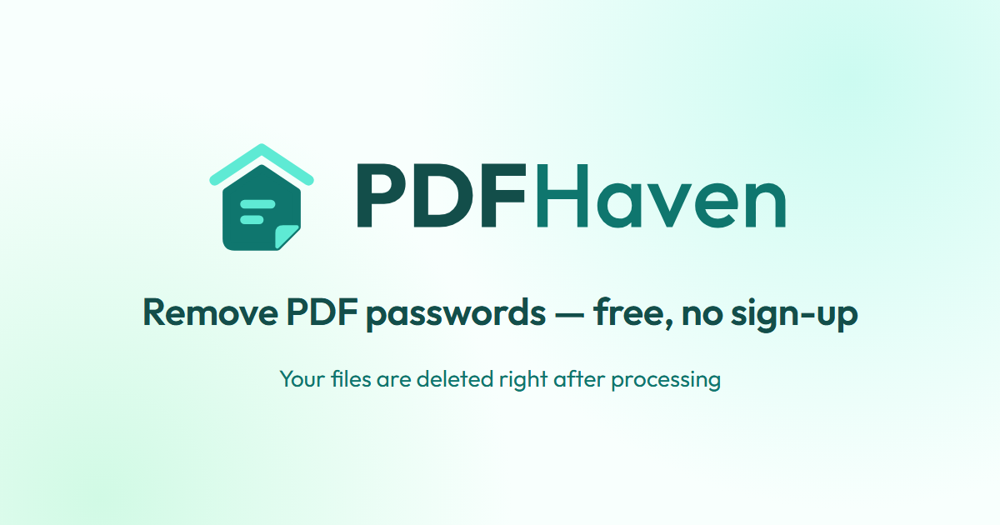

<p align="center">
  <a href="https://pdf-fe-kappa.vercel.app/">
    
  </a>
</p>

<p align="center">
  <strong>Remove the password from a PDF you have the password for — free, no sign-up.</strong>
</p>

<p align="center">
  <a href="https://pdf-fe-kappa.vercel.app/"><strong>Live site</strong></a> ·
  <a href="https://pdf-fe-kappa.vercel.app/pdf-password-remover">PDF Password Remover</a> ·
  <a href="https://pdf-fe-kappa.vercel.app/docs">API Docs</a> ·
  <a href="https://pdf-fe-kappa.vercel.app/privacy">Privacy</a>
</p>

---

# Unclasp — PDF Password Remover

Unclasp is a free, browser-first PDF utility. Unlock a password-protected PDF
when you know its password, or use PDF Tools Studio to merge PDFs, extract or
remove pages, reorder and rotate pages, crop pages, add page numbers or a text
watermark, edit basic metadata, update AcroForm text fields, and convert
JPG/PNG images to PDF. These public tools run locally in browser code and have
no application upload fallback in the inspected source. Automated browser
network interception has not independently verified that behavior.

👉 **Try it: [pdf-fe-kappa.vercel.app/pdf-password-remover](https://pdf-fe-kappa.vercel.app/pdf-password-remover)**



## Features

- **Remove a PDF open password** when you know the current password.
- **PDF Tools Studio** — merge, split/extract, remove and reorder pages, rotate,
  crop, add page numbers or text watermarks, edit standard metadata fields, and
  convert JPG/PNG images to PDF, render PDF pages to JPG, extract selectable
  text to Markdown, and compare selectable text between PDFs. PDF edits use
  [pdf-lib](https://github.com/Hopding/pdf-lib) (MIT); rendering/text extraction
  use [PDF.js](https://github.com/mozilla/pdf.js) (Apache-2.0), loaded only on
  the tool route. Limits are 20 MB and 500 pages per PDF; rendering is limited
  to 50 pages, 16 megapixels per page, and 25 megapixels total. Encrypted PDFs must first be unlocked
  with the local qpdf tool. Markdown/text compare cannot OCR scanned pages or
  preserve visual layout.
- **No account or imposed watermark** — free to use. You may optionally add
  your own text watermark with the watermark tool.
- **Unlocked in your browser** — the website tool runs [qpdf](https://github.com/qpdf/qpdf)
  (WebAssembly) in a Web Worker; there is no upload fallback in the inspected
  source. Browser network behavior has not yet been verified. See the
  [privacy policy](https://pdf-fe-kappa.vercel.app/privacy).
- **Developer API** — a separate, backend-dependent HMAC-SHA256 service with
  Python, Node.js and Go examples. Its PDF requests are uploaded to the API
  server. See the [API docs](https://pdf-fe-kappa.vercel.app/docs).
- **Responsive** with light and dark themes.

> Unclasp does **not** crack or recover forgotten passwords. Use it only on
> documents you own or are authorised to modify.

## Tech stack

| Part | Stack | Repository |
| --- | --- | --- |
| Frontend (this repo) | Angular 19, SSR prerendering, Bootstrap, Angular Material | [PDF_Password_Remover_Angular](https://github.com/mr-ask-chay/PDF_Password_Remover_Angular) |
| Backend | Flask (Python) | [PDF_Password_Remover_Flask](https://github.com/mr-ask-chay/PDF_Password_Remover_Flask) |
| Hosting | Vercel (frontend), Render (backend) | — |

## Run locally

Requires Node.js 20+.

```bash
git clone https://github.com/mr-ask-chay/PDF_Password_Remover_Angular.git
cd PDF_Password_Remover_Angular
npm install
npm start            # http://localhost:4200 (browser-based PDF tools need no backend)
```

The public website PDF tools work without the Flask backend. The separately
documented developer API and API-key management still require the existing
[Flask backend](https://github.com/mr-ask-chay/PDF_Password_Remover_Flask).

```bash
npm test                                   # unit tests (Karma + Jasmine)
npx ng build --configuration production    # production build + prerendered pages
```

## How it works

1. Choose a PDF or supported JPG/PNG images.
2. Select an operation and its options (for page tools, page numbers are
   one-based and ranges use forms such as `1-3,5`).
3. Processing takes place in your browser. The PDF Tools Studio currently
   accepts unencrypted PDFs up to 20 MB and 500 pages; merge accepts up to 20
   files and 40 MB total. Metadata editing changes title, author, subject, and
   keywords only.
4. Download the generated file. The separate API is not used as a fallback.

The API docs remain a distinct server-side product; its files are uploaded to
the Flask API service. Do not enter sensitive documents into the API unless
you accept its server-side processing and retention policies.

## Legal

[Privacy Policy](https://pdf-fe-kappa.vercel.app/privacy) ·
[Terms of Use](https://pdf-fe-kappa.vercel.app/terms)

## Contributing

Contributions are welcome — see [CONTRIBUTING.md](CONTRIBUTING.md) and the
[Code of Conduct](CODE_OF_CONDUCT.md). Report security issues as described in
[SECURITY.md](SECURITY.md).

## Contact

Built by **Sai Krishna Chaitanya** —
[GitHub](https://github.com/mr-ask-chay) ·
[Linktree](https://linktr.ee/mr_ask_chay)

## License

[MIT](LICENSE)
